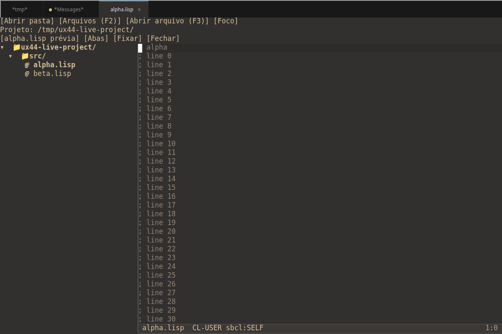

# Navegação por arquivos — issue #44

A tela inicial agora oferece **Abrir projeto/pasta**, projetos recentes, arquivos
abertos e recentes. A barra permanece disponível sobre o código e os painéis:
**Abrir pasta**, **Arquivos (F2)**, **Abrir arquivo (F3)**, **Foco**, abas,
**Fixar** e **Fechar**. O caminho do projeto aparece na segunda linha; caminhos
longos são abreviados na barra e aparecem completos na página Arquivos.

Na página Arquivos, use clique ou Tab/Shift-Tab e Enter. Escape e **Cancelar**
voltam ao editor. O seletor permite subir, entrar e abrir uma pasta; cancelar
preserva o projeto e o arquivo anteriores. A árvore usa o filer existente do Lem,
incluindo seus cliques de expansão e abertura de arquivos.

A busca filtra nomes/caminhos relativos ao projeto, sem exigir um acorde de
teclas. Resultados e arquivos recentes abrem uma **prévia** substituível. **Fixar**
ou editar preserva a prévia; arquivos já abertos nunca são removidos ao trocar
uma prévia. **Abas** apresenta todos os arquivos quando não cabem na barra.
Fechar um arquivo modificado apresenta **Salvar e fechar**, **Descartar alterações**
e **Cancelar**. Arquivos/pastas recentes indisponíveis indicam a remoção/movimentação
e orientam a escolher outra localização, sem criar buffers vazios.

**Foco** esconde a árvore; **Arquivos → Mostrar árvore** a recupera. Os botões das
abas continuam disponíveis durante chat/revisão. Trocar entre Arquivos e edição
reutiliza a preservação de cursor, seleção e rolagem do Lem.

## Verificação executada em 2026-10-20

- Teste red: a suíte falhou com o componente de navegação ausente; passou após a implementação.
- `asdf:test-system :yeditor-navigation-tests`: interação com callbacks reais dos
  botões, Tab/Enter, busca assíncrona, cancelamento, arquivo ausente, prévia/fixação,
  confirmação e descarte/salvamento, sidebar emprestada e callbacks tardios.
  Inclui 100 ciclos que comparam buffers, cabeçalhos, hooks, F2/F3, splash e
  dimensões da janela com o estado inicial. Seleção e rolagem têm teste específico.
- `sbcl --script scripts/run-yeditor-all-tests.lisp`: todas as suítes passaram.
  Uma execução concorrente excedeu o orçamento de 100 ms do teste de replay T9;
  a repetição isolada passou (mediana 56 ms), sem alterar esse teste/orçamento.
- `sbcl --script scripts/run-yeditor-agent-smoke-tests.lisp`: passou.
- `python3 scripts/test-navigation-terminal.py`: ncurses real em PTY, **80×24 e
  120×32**, `TERM=xterm-256color`; clique no seletor e em Fixar, Tab/Enter/Escape,
  busca/prévia, fechamento modificado com cancelar/descarte e ferramentas MCP
  retornando objetos JSON. Requer `lem-ncurses` e a biblioteca nativa instalados.
- Frontend **lem-server/web** real, Chromium headless em **1200×800**, com Playwright:
  abertura de pasta por clique, árvore, busca/prévia e F2 → Tab → Enter. A captura
  acima vem desse runtime, sem uma simulação da tela.
- Gate de cabeçalhos/licenças e `git diff --check`: passaram.

Para repetir o caminho gráfico, carregue `lem-server` e `yeditor-components`,
registre `yeditor-components:enable-ephemeral-ui` em `lem:*after-init-hook*` com
peso -10 e execute `lem-server:run-websocket-server` em uma porta local. Abra essa
porta no navegador. O primeiro carregamento pode exigir as dependências opcionais
do frontend via Quicklisp. O teste aqui usou o mesmo cliente canvas distribuído
com o editor; não validou a janela nativa WebKit/macOS nem SDL2.

O primeiro CI do PR encontrou uma corrida na fixture do teste T8: uma sobrescrita
no próprio arquivo expunha uma configuração vazia ao watcher. A fixture agora
publica configurações completas por rename atômico, mantendo as 50 trocas e todas
as asserções. A recarga de gravações parciais no runtime foi reproduzida isoladamente
(escritor pausado 50 ms) e está registrada na #54; esta entrega não altera o watcher.

## Operação e limites

`le-navigation` possui instalação/desinstalação reversível e restaura a UI
emprestada, splash e atalhos anteriores. A enumeração de pastas e o índice rodam
em workers, com cancelamento cooperativo; somente o componente ainda ativo recebe
resultados na fila da UI. A árvore continua usando o comportamento do filer.
O índice ignora `.git`, `.qlot`, `node_modules`, `.cache` e `.venv`, evita recursão
por diretórios fora da raiz/ciclos e limita a exibição a 80 resultados por filtro.
**Atualizar índice** inclui arquivos novos/movidos; não há watcher nesta entrega.
Esta busca não procura texto dentro dos arquivos (#51).

MCP expõe `yeditor_navigation_action` e `yeditor_navigation_status`. O botão, o
atalho e o agente compartilham as operações. A ferramenta de busca exige `query`
explícito (string vazia lista tudo), evitando abrir um prompt sem resposta para o
agente. Fechamento modificado exige uma segunda ação explícita. Esses controles
não implementam a revisão de alterações da IA (#46).

A correção mínima em `frontends/ncurses/input.lisp` impede que o ncurses consuma
`ESC[<` como `KEY_MOUSE` antes do parser SGR: o clique havia sido interpretado como
texto e gerava “Read Only”. O teste PTY cobre essa regressão. A issue #42 continua
responsável pelos popups de logs HTTP que podem cobrir temporariamente o conteúdo.
